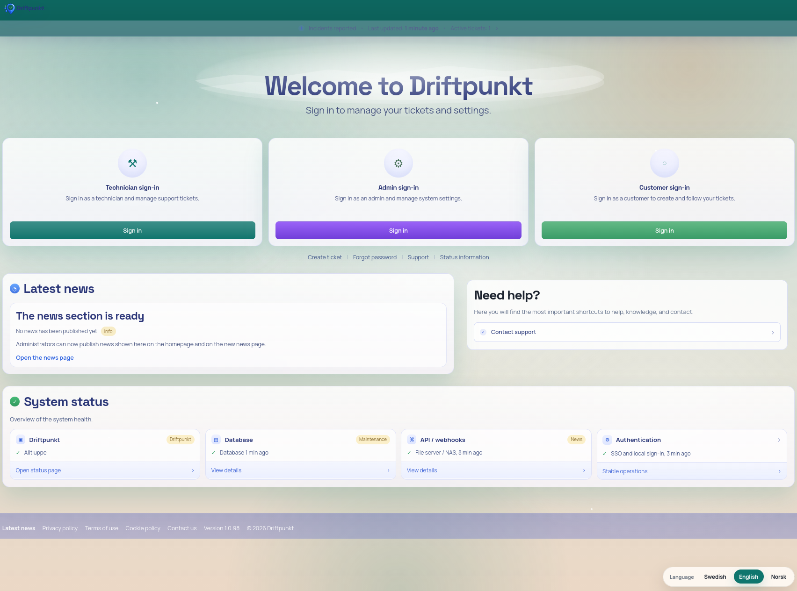
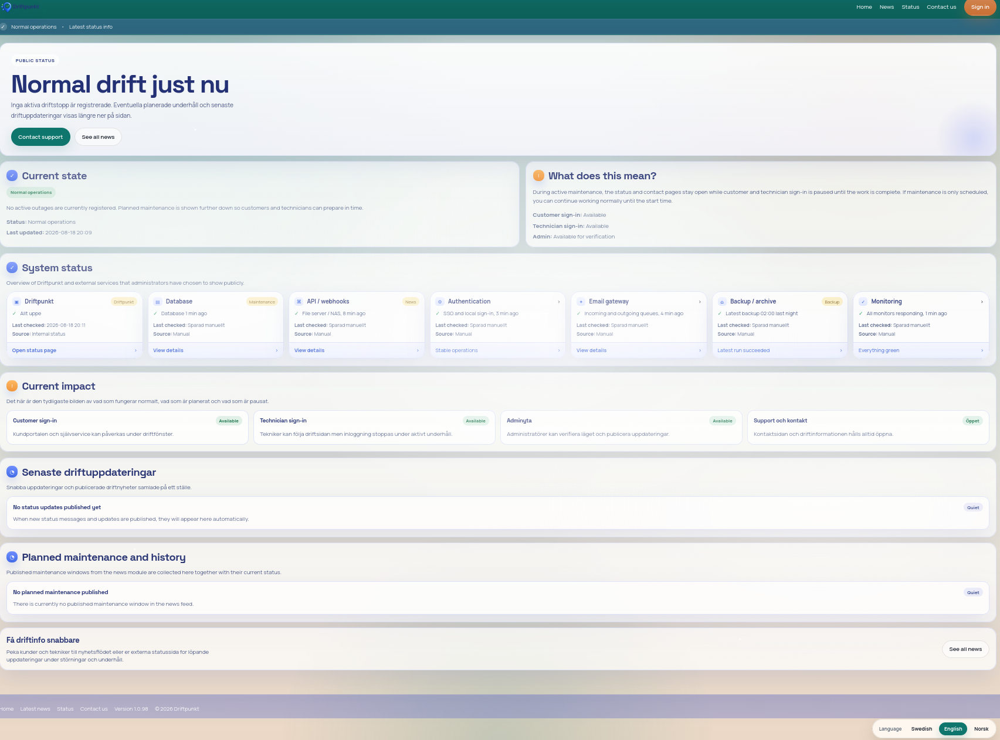
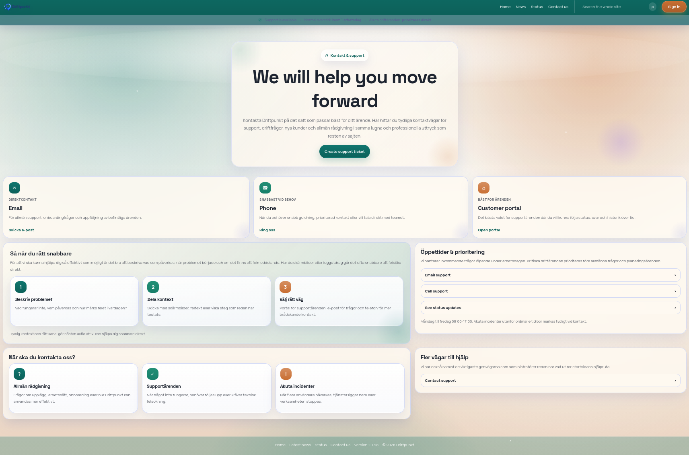
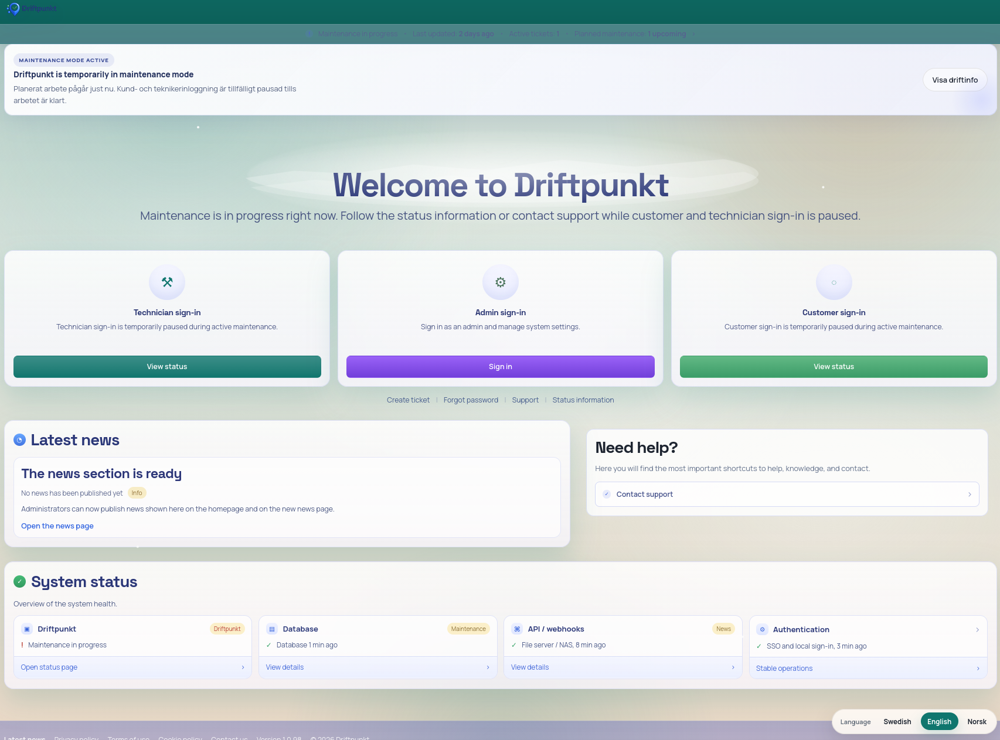
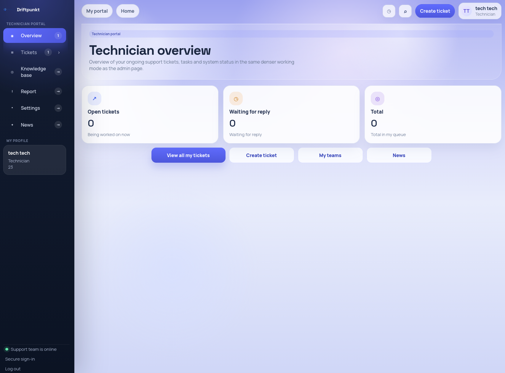
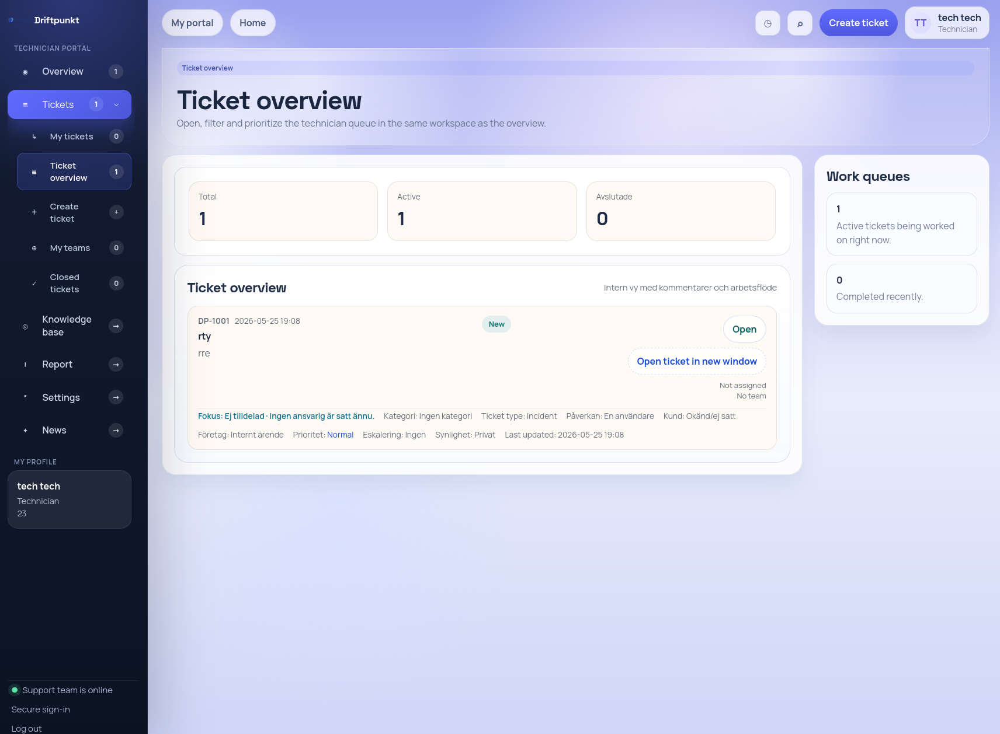
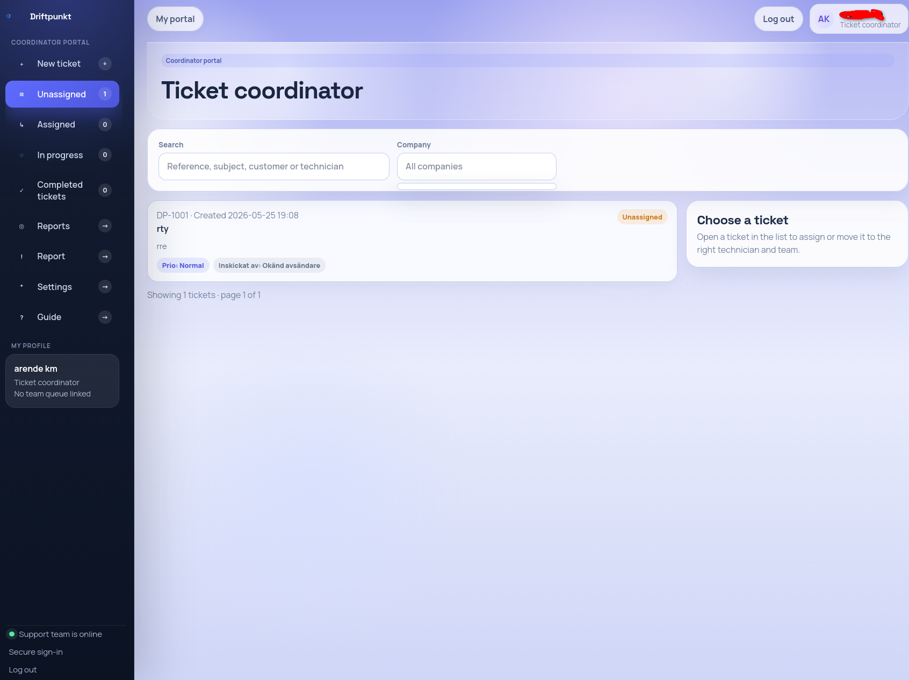
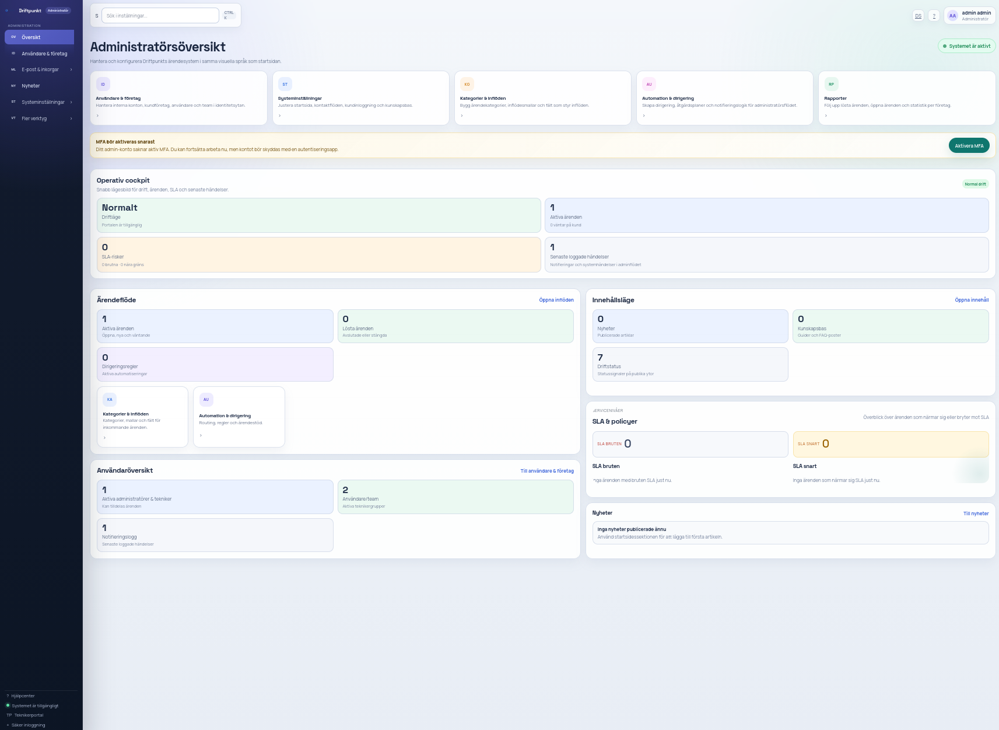

# Driftpunkt Release Packages


Driftpunkt is a support and operations platform for handling tickets, customer communication, technician work queues, operational status updates, knowledge base content, reports, company administration, and maintenance workflows.

This public repository distributes release archives, documentation, and selected screenshots. The archives include application code and dependencies needed to run Driftpunkt; private Git history, internal planning documents, live environment files, and runtime customer data are not exported.

The screenshots may show the Swedish interface. Language and branding can be changed after installation through the running application and its environment-specific configuration.

## Recent Improvements

- Ticket coordinators can close active and resolved tickets, including unassigned tickets, with a required resolution. Administrative closing sets status Closed, records the closing time, and sends no customer email.
- Saved resolutions remain visible in a separate read-only panel after closing. Repeating a close request preserves an already closed ticket's resolution and closing time.
- Ticket coordinators can change priority without changing status, resolution, assignments, or the SLA policy.
- Closing and priority changes require coordinator permissions and CSRF protection, record the acting user and before-and-after values in ticket history, and preserve read-only merged source tickets.
- Forwarded messages and forwarded delivery failures keep their forwarded content in the ticket, while the customer's own signature is still removed.
- Technicians can read the complete original email below the ticket description and download it as an `.eml` file.
- Auto-replies and bounces no longer create tickets, machine-sent alerts never receive confirmations, and confirmations are rate-limited per sender to prevent mail loops.
- Company badges show the company name and icon without a redundant label.
- New review drafts from unknown mail senders notify the configured triage recipients and link to the matching draft in the coordinator queue. Delivery failures are logged.
- Company email domains route unknown senders arriving at a parent inbox to the correct subsidiary. Automatic registration remains off by default; when enabled, it creates contacts on the matched company.
- Customer access to internal comment attachments is blocked, and email replies follow the same access rules as the portal.
- Login and MFA have account-based attempt limits, while public forms have additional IP-based limits.
- Password reset and translation output escaping, attachment extensions, and database backup and restore error handling have been improved.
- Technicians and coordinators can add personal signatures to customer emails and send a separate copy to their own account address.

## Screenshots

| Public homepage | Public status |
| --- | --- |
|  |  |

| Contact page | Maintenance mode |
| --- | --- |
|  |  |

| Technician overview | Technician ticket queue |
| --- | --- |
|  |  |

| Ticket coordinator | Admin dashboard |
| --- | --- |
|  |  |

## What Driftpunkt Includes

- A public website for the homepage, operational status, news, search, contact details, public knowledge base content, and legal policy pages.
- Public ticket intake for visitors when the feature is enabled, plus authenticated customer portals for ongoing support dialogue.
- Customer accounts for both company customers and private customers, including password reset, language switching, personal light, dark, system, and high-contrast portal themes, ticket follow-up, comments, feedback, and customer-visible knowledge base content; super administrators can provision multiple company customers at once with secure temporary passwords.
- Customer-facing resources such as allowlisted company reports, computer lists, and printer lists under a translated "My resources" menu when those resources are enabled.
- Technician and ticket coordinator portals for queue work, triage, comments, assignment, conditional SLA follow-up, reports, activity, notifications, company inventory lookup, and internal issue or feature-request reporting, with a focused two-column technician ticket workbench and clearer personal ticket filtering.
- Full ticket lifecycle support with statuses, priorities, impact levels, request types, routing rules, teams, multiple responsible technicians, internal notes, customer-visible replies, attachments, checklists, playbooks, and customer feedback reminders.
- Admin tools for identity, companies, company hierarchies, teams, mail, ticket categories, intake templates, routing, SLA policies, public content, reports, logs, background jobs, settings, updates, and maintenance mode, with identity work split into focused user, customer, team, appearance, and triage sections.
- Mail ingestion through spool or mailbox polling, incoming mail review, correction drafts, mailbox routing, outgoing profiles, ticket notification emails, and technician/customer links back to the related ticket.
- Knowledge base and news management with public, customer, technician, and admin-facing workflows, optional technician contributions, smart tips, FAQ-style content, and status communication.
- Operational tooling for read-only ticket API access, monthly company reports, database jobs, backups, restore/optimize tasks, migration runs, code update staging, package application, addon package registration, log export, and controlled cleanup.
- Localization and personalization for Swedish, English, and Norwegian UI text, personal default language in technician, coordinator, admin, and super admin workflows, global default/selectable language governance, customer portal themes, optional lightweight seasonal appearance, branding assets, MFA settings, remote support shortcuts, and internal portal theme templates.
- Release packages with bundled dependencies, metadata, release notes, post-update guidance, and SHA-256 checksums.

## Profiles and What They Can Do

Visible features depend on enabled settings, company access, and role permissions, but Driftpunkt currently supports these main profiles:

### Public Visitor

- Read the public homepage, operational status, news, public knowledge base articles, contact page, and legal pages.
- Search public content from the server-rendered website.
- Create a public support ticket without signing in when public ticket intake is enabled.
- Follow general status and maintenance information published by the service team.

### Company Customer

- Sign in to the customer portal and follow tickets connected to the customer account or shared through the company.
- Create tickets, add customer comments, see ticket status, and participate in the support dialogue for tickets they can access.
- Read customer-visible knowledge base content and operational status information.
- Leave feedback on resolved or closed tickets when customer feedback is enabled.
- Open company resources such as reports, computer lists, and printer lists when the company has the feature enabled and the specific user has been granted access.
- Use customer reports only when explicitly allowlisted by an admin for that company user.
- Switch portal language between Swedish, English, and Norwegian and choose a personal system, light, dark, or high-contrast portal theme.

### Private Customer

- Register a private customer account when self-registration is enabled.
- Sign in, reset password, create personal support tickets, comment on accessible tickets, and follow personal case status.
- Read customer-visible knowledge base and status information.
- Provide feedback on completed tickets when the feedback workflow is enabled.
- Private customers are separate from company report/resource access, which is controlled per company user.

### Technician

- Work from a technician overview built around assigned tickets, team tickets, queue health, recent activity, and notifications, with SLA cards and controls shown only when SLA is enabled and actively used.
- Open separate personal queues for tickets owned as the primary technician and tickets assigned as a supporting technician, each with a direct sidebar link and count.
- Create tickets, take over tickets, assign work, update status, priority, impact, request type, routing, optional SLA fields, checklist progress, and internal work notes.
- Reply to customers, add internal comments, use ticket attachments when enabled, and follow links from technician notification emails back to the related ticket.
- See all tickets or only permitted tickets depending on the technician access setting.
- Use knowledge base and news contribution workflows when enabled.
- Report bugs, improvements or feature requests, and missing customers to super administrators from the technician menu.
- Use technician inventory views, remote support shortcuts, secure login/MFA with configurable trusted devices (14 days by default), personal default language, and selectable portal theme templates, including the burgundy Bordeaux theme.

### Ticket Coordinator

- Use a coordinator overview for unassigned work, stale tickets, waiting customer cases, workload, and triage signals, with SLA signals shown only when SLA is in use.
- Distribute tickets to technicians or teams, follow company and queue health, add comments, and keep cases moving without needing full admin access.
- Change ticket priority without changing status, resolution, assignments, or the SLA policy.
- Close active and resolved tickets with a required resolution, including unassigned tickets. Administrative closing sends no customer email; the saved resolution remains visible, and merged source tickets stay read-only.
- Open clearer coordinator and customer reports by company and period for inflow, backlog, status, priority, impact, request type, escalation, risk, ticket aging, and SLA only when applicable.
- Follow an expanded coordinator guide for assignment, priority changes, tickets in progress, closing, comment visibility, reopening, and reporting, and submit internal reports from the same portal.
- View company data plus computer and printer inventory when data exists and access is available.
- Save a personal default language so the coordinator portal opens in the preferred language on the next login.

### Admin

- Manage regular operational administration: tickets, companies, users that are not privileged beyond their permission level, teams, categories, routing rules, intake templates, SLA policies, and support settings.
- Configure customer portal features, company hierarchy visibility, ticket attachments, feedback, monthly company reports, MFA policy, remote support tools, public ticket intake, and customer self-registration.
- Manage public content such as homepage settings, contact information, news, status messaging, knowledge base settings, translation languages, selectable language settings, UI translation overrides, privacy policy, terms, and cookie policy.
- Manage mail servers, support inboxes, outgoing mail profiles, incoming mail review, correction drafts, and mailbox-based ticket creation.
- Use admin reports for ticket inflow, backlog, SLA health, risk, companies, and internal workload.
- Review application logs and notification logs, with super-admin-only controls hidden where appropriate.

### Super Admin

- Has full system and operational access, including all admin and technician capabilities.
- Create or assign privileged profiles such as super admin, admin, and ticket coordinator.
- Create multiple company customer accounts in one operation, with automatic secure temporary passwords and forced password changes at first sign-in.
- Review internal reports from technicians and ticket coordinators, update their status, and leave reporter-visible feedback.
- Reset or disable MFA for locked-out users without exposing their MFA secret or enrollment QR code; recovery actions are audit logged.
- Manage destructive or infrastructure-sensitive actions such as database backup/download/restore/optimize, migration execution, code update staging/application, post-update tasks, job retry/purge, log export/cleanup, test ticket purge, branding, support branding, and addon package lifecycle.
- Configure global maintenance mode, timezone, default language, selectable languages, optional seasonal appearance for the public homepage and customer portal, system status monitor settings, public ticket form controls, privileged mail tests, knowledge base controls, remote support download URLs, and secure update flows.

### System and Automation

- Poll support mailboxes or process mail spool input and create tickets or draft reviews from incoming messages.
- Run due operational tasks for mail polling, SLA checks, monthly reports, customer feedback reminders, attachment archiving, database jobs, and post-update steps.
- Provide a read-only token-based ticket API for controlled exports.
- Build and apply cumulative install/upgrade packages with vendor dependencies included, release metadata, and checksum verification.

## Packages

- Current exported release: `1.0.127`.
- Fresh installation package: `packages/driftpunkt-install-1.0.127.zip`
- Newest cumulative upgrade package: `packages/driftpunkt-upgrade-1.0.127.zip`
- Older upgrade packages are kept as fallback and history, up to the latest 3 upgrade builds available during export.
- SHA-256 checksum files are generated beside every package.
- Public README assets exported here: 15.

## Latest Release Notes

These notes are copied from the packaged release metadata for the current exported version.

### Driftpunkt 1.0.127

### Fixed and improved

- Ticket coordinators can close active and resolved tickets from the ticket page, including tickets without an assigned technician. A non-empty resolution is required. Closing sets the status to **Closed**, records the closing time, and sends no customer email, following the existing administrative closing behavior.
- The saved resolution appears in a separate read-only panel, including after the ticket is closed. Repeating a close request for an already closed ticket preserves its resolution and closing time.
- Ticket coordinators can change ticket priority without changing status, resolution, assignments, or the SLA policy.
- The coordinator guide explains closing and priority changes in Swedish, English, and Norwegian. Reopening still requires an internal reason and sets the status to **Open**.

### Access and history

- Both actions require the ticket coordinator role and a valid CSRF token. Coordinators do not receive broader technician permissions.
- Closing and priority changes record the acting user and before-and-after values in the ticket history. Repeating an unchanged action does not add another history entry.
- Merged source tickets remain read-only. Closing and priority changes are available on the main ticket.

### Database and operations

- Database migration required from 1.0.126: no. This release adds no new migration. Upgrades from older versions must still apply the existing migrations through the normal update flow.
- Cache refresh required: yes.
- PHP/OPcache restart or reload recommended: yes.
- Back up application files and the database before upgrading.
- Use the normal update flow to apply the package and complete post-update tasks. Existing ticket assignments and SLA policies are preserved.

### Post-update verification

- Confirm that the admin area shows version `1.0.127` and the update job has completed.
- Sign in as a ticket coordinator, change the priority of a test ticket, and confirm that its status, resolution, and assignments are unchanged. Check the acting user and before-and-after values in the ticket history.
- Close an active test ticket with a resolution, including a ticket without an assigned technician. Confirm the **Closed** status, closing time, saved resolution in the read-only panel, and placement under **Closed tickets**. Confirm that closing sends no customer email.
- Confirm that an empty resolution prevents closing without changing the ticket. Repeated closing of an already closed ticket must preserve its resolution and closing time without adding another history entry.
- Open a resolved test ticket and confirm that it can be closed with its existing resolution.
- Open a merged source ticket and confirm that the closing and priority forms are absent. Confirm that the main ticket remains writable.
- Confirm that reopening still requires an internal reason and sets the ticket status to **Open**.

## What This Repository Contains

- `packages/`: install and upgrade zip files.
- `packages/*.sha256`: checksum files for package verification.
- `assets/`: logo and screenshots used by this README.
- `PUBLIC_EXPORT_MANIFEST.md`: export summary with package versions and checksums.

## Fresh installation

Use the install package for a new server, NAS, or clean application directory.

1. Download the latest `driftpunkt-install-*.zip` file and its matching `.sha256` file from `packages/`.
2. Verify the package before unpacking it:

```bash
cd packages
sha256sum -c driftpunkt-install-1.0.127.zip.sha256
```

3. Create a clean application directory on the target server or NAS.
4. Unpack the zip file into that directory.
5. Point the web server document root to the unpacked application directory's `htdocs/` folder. On shared hosting where the fixed public directory is already named `/htdocs`, unpack the whole package there and keep the package root `.htaccess` enabled.
6. Configure the environment file for your deployment. Start from the example files included inside the package and set real secrets, database credentials, mail settings, and domain-specific values.
7. Start the database and web runtime for your deployment model.
8. Run the installer from the unpacked application directory:

```bash
php bin/console app:install:fresh --env=prod
```

9. Create the first super administrator. The command prompts for and confirms the password without echoing it:

```bash
php bin/console app:create-admin admin@example.com --first-name=First --last-name=Last --type=super_admin --env=prod
```

10. Sign in and open **Settings → Access → MFA policy**. Create or import the MFA encryption key, choose MFA availability, optionally choose required roles, and select the trusted-device period. No role is forced to use MFA automatically.

## Install on a new Debian server

This flow installs Driftpunkt without Docker on a clean Debian server. Replace `driftpunkt.example.com`, passwords, and mail settings before production use.

1. Install the tools needed to unpack the release package:

```bash
sudo apt-get update
sudo apt-get install -y unzip
```

2. Download or copy `driftpunkt-install-1.0.127.zip` and `driftpunkt-install-1.0.127.zip.sha256` to the server, then verify the package:

```bash
sha256sum -c driftpunkt-install-1.0.127.zip.sha256
```

3. Unpack the release into `/var/www/driftpunkt`:

```bash
rm -rf /tmp/driftpunkt-install
mkdir -p /tmp/driftpunkt-install
unzip driftpunkt-install-1.0.127.zip -d /tmp/driftpunkt-install
sudo mkdir -p /var/www/driftpunkt
sudo cp -a /tmp/driftpunkt-install/driftpunkt-install-1.0.127/. /var/www/driftpunkt/
cd /var/www/driftpunkt
```

4. Run the Debian setup script. It installs Apache, PHP packages, MariaDB, Composer, logrotate, and Driftpunkt systemd timers:

```bash
DOMAIN=driftpunkt.example.com sudo -E bash deploy/debian/setup.sh
```

5. Edit `/var/www/driftpunkt/.env.local` and set real values for `APP_SECRET`, `DEFAULT_URI`, `DATABASE_URL`, `MAILER_DSN`, and `MAILER_FROM`:

```bash
sudo nano /var/www/driftpunkt/.env.local
```

6. Create the MariaDB database and user. Use the same password in `DATABASE_URL`:

```bash
sudo mariadb
```

```sql
CREATE DATABASE driftpunkt CHARACTER SET utf8mb4 COLLATE utf8mb4_unicode_ci;
CREATE USER 'driftpunkt'@'localhost' IDENTIFIED BY 'change-this-database-password';
GRANT ALL PRIVILEGES ON driftpunkt.* TO 'driftpunkt'@'localhost';
FLUSH PRIVILEGES;
EXIT;
```

7. Initialize Driftpunkt:

```bash
sudo -u www-data php /var/www/driftpunkt/bin/console app:install:fresh --env=prod
sudo -u www-data php /var/www/driftpunkt/bin/console app:create-admin admin@example.com --first-name=First --last-name=Last --type=super_admin --env=prod
```

8. Confirm that Apache serves `/var/www/driftpunkt/htdocs`, then reload Apache and add HTTPS, for example with Certbot:

```bash
sudo apache2ctl configtest
sudo systemctl reload apache2
sudo apt-get install -y certbot python3-certbot-apache
sudo certbot --apache -d driftpunkt.example.com
```

9. After the database, first account, backups, and application access have been verified, enable the external background timers:

```bash
sudo systemctl enable --now driftpunkt-mail-poll.timer driftpunkt-attachment-archive.timer
systemctl list-timers 'driftpunkt-*' --all --no-pager
```

Attachment ZIP archiving is configured under **Administration → Settings → Tickets → Ticket attachments**. A retention value of `0` archives local attachments as soon as a ticket is resolved or closed. Choose a higher value when recently closed tickets should keep separate files for a grace period. If the installation uses a custom Unix account, application path, or PHP binary, update `driftpunkt-attachment-archive.service` accordingly before enabling it.

## Install on a new NAS with Docker Compose

This flow uses the Docker Compose stack included inside the install package. Adjust `/volume1/docker/driftpunkt` to the application path used by your NAS.

1. Copy `driftpunkt-install-1.0.127.zip` and `driftpunkt-install-1.0.127.zip.sha256` to the NAS, then verify the package:

```bash
sha256sum -c driftpunkt-install-1.0.127.zip.sha256
```

2. Unpack the release into a persistent NAS folder:

```bash
rm -rf /tmp/driftpunkt-install
mkdir -p /tmp/driftpunkt-install /volume1/docker/driftpunkt
unzip driftpunkt-install-1.0.127.zip -d /tmp/driftpunkt-install
cp -a /tmp/driftpunkt-install/driftpunkt-install-1.0.127/. /volume1/docker/driftpunkt/
cd /volume1/docker/driftpunkt
```

3. Create and edit the NAS environment file:

```bash
cp deploy/nas/.env.example deploy/nas/.env
nano deploy/nas/.env
```

Set real values for `APP_SECRET`, `DEFAULT_URI`, `MARIADB_PASSWORD`, `MARIADB_ROOT_PASSWORD`, `DATABASE_URL`, `MAILER_DSN`, and `MAILER_FROM`. After signing in, configure the internal-report recipient and reply mailbox in the super-admin cockpit.

4. Create persistent data folders and start the stack:

```bash
mkdir -p deploy/nas/data/var deploy/nas/data/mariadb
docker compose -f deploy/nas/compose.yaml --env-file deploy/nas/.env up -d --build
```

5. Initialize Driftpunkt inside the app container:

```bash
docker compose -f deploy/nas/compose.yaml --env-file deploy/nas/.env exec --user www-data app php bin/console app:install:fresh --env=prod
docker compose -f deploy/nas/compose.yaml --env-file deploy/nas/.env exec --user www-data app php bin/console app:create-admin admin@example.com --first-name=First --last-name=Last --type=super_admin --env=prod
```

6. Open the URL from `DEFAULT_URI`, sign in, configure the MFA policy without enabling mandatory MFA unless explicitly wanted, and confirm that the app and scheduler containers are healthy:

```bash
docker compose -f deploy/nas/compose.yaml --env-file deploy/nas/.env ps
docker compose -f deploy/nas/compose.yaml --env-file deploy/nas/.env logs -f app scheduler
```

## Automatic Customer Registration and Company Groups

As super administrator, edit an inbox, link an active company, allow unknown senders, and enable automatic customer registration. Configure exact sender domains on the inbox or email domains on the company and its subsidiaries under Administration → Companies, for example `company.example`. Enter subdomains separately; do not use `@` or wildcards.

A sender domain matching an active company in the inbox company branch creates the new contact on that company and a private ticket. Company domains take precedence over the inbox domain list. If only the inbox domain list matches, the inbox company is used. Existing contacts and aliases in the same branch are reused without moving contacts between companies.

Company domains can also route review drafts to the correct subsidiary when automatic registration is disabled. Drafts requiring review notify the configured triage recipients and link to the Unknown tickets queue. If an inbox rejects unknown senders, their messages are rejected even when they contain a reply or ticket reference.

To retain the previous workflow for a company group:

1. Sign in as super administrator and open Administration → Companies.
2. Open the parent company, enable **Behåll tidigare mejlhantering** (keep previous mail handling), and save the mail settings.
3. The exception applies to the parent and all descendants at every level, even when their inbox automation is enabled.

A child cannot override an inherited exception. The company and inbox views show its source. Removing an exception restores saved inbox settings unless another ancestor still has an exception. Existing contacts, tickets, and review drafts remain unchanged.

Automatically registered contacts receive no portal invitation. Login, login links, existing portal sessions, and password reset are blocked until an administrator enables **Portalåtkomst** (portal access) in the user form. Domain matching is a company-routing rule, not identity verification.

Enable this first on a test inbox. For multiple application servers, configure a shared `LOCK_DSN`; with default file locking, web and scheduler must share `var/lock`. The archives include `docs/automatic-mail-customer-registration.md` with setup, migration, and troubleshooting instructions.

## Recovering from the 1.0.120 Cache Error

If migrations succeeded but the apply log reports `Refresh prod-cache` and `Directory not empty`, run this inside the PHP container as the application user. It clears and warms the production cache:

```bash
cd /var/www/html
php bin/console cache:clear --env=prod --no-debug --no-interaction
```

On a regular server, use the actual application directory. Expect an `[OK]` result, then check login, ticket views, and mail processing. Manual recovery does not rewrite a historical failed apply log.

Version 1.0.121 uses this command in required and manual post-update tasks. An apply process started with older code may still run the old cache step once; if that happens, repeat the recovery command. There is no new migration beyond 1.0.120, and a completed migration is not repeated.

## Upgrade an existing installation

1. Use the newest cumulative `driftpunkt-upgrade-*.zip` package first. It contains the full current codebase and is the normal path even when the installed site is several releases behind.
2. Back up the database and application files before applying the upgrade.
   Preserve `.env.local` and its `APP_SECRET` in an encrypted, restore-tested backup. The secret is required to unwrap the stored MFA encryption key. Include `var/ticket_attachments` and `var/ticket_attachment_archives` in file backups.
3. Verify the checksum before using the package:

```bash
cd packages
sha256sum -c driftpunkt-upgrade-<version>.zip.sha256
```

4. Apply the package through the Driftpunkt admin update flow when available, or unpack it according to your deployment procedure.
5. Confirm that the web server document root points to `htdocs/`, or that the package root `.htaccess` is active when the whole package lives in a fixed `/htdocs` directory.
6. Run database migrations, cache refresh, service reloads, and any other post-update steps listed in the package metadata and release notes.
7. For version 1.0.21 or later, also verify Admin -> Identity links to the dedicated company page and Admin -> Companies paginates company groups correctly.
8. Older upgrade packages are kept as fallback and history, not as required intermediate steps.
9. Verify login, ticket creation, customer/technician portals, status page, and background jobs before leaving maintenance mode.
10. Verify `systemctl --failed`, mail polling, and the attachment-archive service log after its first scheduled run.

### Upgrading from 1.0.126 to 1.0.127

- Use the latest `driftpunkt-upgrade-1.0.127.zip` and its matching checksum.
- No new database migration is required from 1.0.126. Let the normal update flow complete its post-update steps, refresh the production cache, then reload PHP/OPcache.
- Sign in as a ticket coordinator, change a ticket priority, and confirm that status and assignments remain unchanged.
- Close an active or resolved ticket with a resolution. Confirm status Closed, the saved resolution, the closing time, and the audit entry. Administrative closing sends no customer email.
- Confirm that merged source tickets remain read-only and that reopening a closed ticket still requires an internal reason.

### Upgrading from 1.0.125 to 1.0.126

- Use the latest `driftpunkt-upgrade-1.0.126.zip` and its matching checksum.
- Migration `Version20261008120000` is required. It adds `original_body`, `raw_message_path` and `automatic_kind` to `incoming_mails`; let the update flow run migrations and refresh the production cache, then reload PHP/OPcache.
- Raw messages are stored under `var/incoming_mail_attachments/<id>/original.eml`. Include that directory in file backups.
- Verify the displayed version, a forwarded message keeping its forwarded content, the original email view and `.eml` download, and that an out-of-office reply is logged as ignored without creating a ticket.

### Upgrading from 1.0.124 to 1.0.125

- Use the latest `driftpunkt-upgrade-1.0.125.zip` and its matching checksum.
- Migration `Version20261001120000` is required. It adds `companies.email_domains`; let the update flow run migrations and refresh the production cache, then reload PHP/OPcache.
- Verify the displayed version, a completed update job, company-domain routing, and customer access to customer-visible attachments.
- Send a test message from an unknown sender to an inbox requiring review. Confirm that the triage notification arrives through the production mail server and opens the correct draft after coordinator login.
- Existing drafts are not notified retroactively, and failed notifications are not retried automatically. Check `unknown_sender_review_created` in the notification log when delivery is missing.

### Interrupted 1.0.45 Migration

Version `1.0.46` and later fix the 1.0.45 customer report migration error `Call to undefined method Doctrine\DBAL\Schema\Table::changeColumn()`. If an upgrade stopped on that error, apply the latest `driftpunkt-upgrade-<version>.zip` and rerun the migration step after the fixed files are in place:

```bash
php bin/console doctrine:migrations:migrate --no-interaction --allow-no-migration --all-or-nothing --env=prod
```

The failed 1.0.45 run stops before Doctrine records the migration as completed, so the patched 1.0.46 migration can normally run again without manual database edits. Always confirm that a fresh database backup exists before resuming an interrupted production upgrade.

## Available upgrade packages

- `packages/driftpunkt-upgrade-1.0.127.zip`
- `packages/driftpunkt-upgrade-1.0.126.zip`
- `packages/driftpunkt-upgrade-1.0.125.zip`

## Notes

- Keep private `.env`, backup, database dump, and customer files outside this repository.
- Driftpunkt release packages prefer `htdocs/` as document root. If the full package must live directly in a fixed `/htdocs` web root, verify that `.htaccess` blocks `config/`, `src/`, `vendor/`, and `var/` before production use.
- Review `PUBLIC_EXPORT_MANIFEST.md` after every export before committing to the public repository.
- If checksum verification fails, do not install the package. Rebuild and export the release from the private repository.
