# Driftpunkt Release Packages

<picture>
  <source media="(prefers-color-scheme: dark)" srcset="assets/branding/logo-wide-v2-dark.svg">
  
</picture>

Driftpunkt is a support and operations platform for handling tickets, customer communication, technician work queues, operational status updates, knowledge base content, reports, company administration, and maintenance workflows.

This public repository distributes release archives, documentation, and selected screenshots. The archives include application code and dependencies needed to run Driftpunkt; private Git history, internal planning documents, live environment files, and runtime customer data are not exported.

The screenshots may show the Swedish interface. Language and branding can be changed after installation through the running application and its environment-specific configuration.
The gallery shows Driftpunkt 2.0 with synthetic demonstration accounts and tickets; it contains no live customer data.

**Stable release: 2.0.3** · [Download releases](https://github.com/K3NT4/Driftpunkt/releases/latest) · [Install](INSTALL.md) · [Upgrade](docs/upgrade_to_2_0_1.md)

Before upgrading to 2.0, follow the [live-server upgrade checklist (English)](docs/upgrade_to_2_0_0.md), including backups, Docker prerequisites and enabling the personal classic/modern layout choice for technicians and ticket coordinators.

For a new installation, start with [INSTALL.md (English)](INSTALL.md): Debian 13 and NAS instructions with explicit fresh-database protection and hidden administrator password input.

## New in 2.0.3

- Technicians and ticket coordinators can choose seasonal portal themes: Spring, Summer, Autumn, Winter, or Season, which switches automatically through the year.
- A personal seasonal decoration can be turned on in **Settings**. It shows Christmas and New Year around the holidays and the current season the rest of the year (off by default).
- Technicians can choose which page opens after sign-in (Overview, My tickets or, for coordinators, the coordinator queue) and hide the key figure cards. Ticket coordinators can choose which selection the queue opens on.
- **Reset to standard** restores the start page, queue and lists while keeping theme and language. All new choices default to the previous behaviour.
- Super administrators can let the public seasonal appearance follow both seasons and holidays automatically. No database migrations; follow [the 2.0.1 upgrade checklist](docs/upgrade_to_2_0_1.md).

## Earlier 2.0 Improvements

- 2.0.2 lets technicians hide **Team latest** on their dashboard and limit the Overview and Tickets menu counts to their own tickets.
- 2.0.1 adds data-only JSON panels for the homepage, customer overview and technician dashboard with validation, preview and versioning; see [the addon guide](docs/addons.md). Executable PHP/Twig ZIP addons and SupportDesk shortcuts are retired; historical data is retained.
- Driftpunkt 2.0 redesigns the public website and all role portals with responsive navigation, clearer queues, visible company labels, accessible controls and working personal themes.
- Customers get clearer search, status, conversation and attachment views; private customers can create tickets without belonging to a company.
- Public pages retain installation branding and can follow the device theme. Administrators can disable system-theme following and subtle seasonal decorations.
- Super administrators can enable a modern/classic presentation choice for technicians and ticket coordinators. Customer accounts use the modern portal with personal colour themes.
- Basic text tools are visible, advanced tools are collapsed, and the toolbar can be hidden without losing a draft.
- Company support cards add revocable QR links and PDF/SVG export. Read-only stable-release notices never install an update automatically.
- Debian 13 and NAS installation helpers provide explicit fresh-database protection. Upgrade packages preserve installation data, mail configuration and private environment files; keep all encryption keys.
- Update completion uses a fresh process after cache replacement. See the upgrade checklist before updating an installation using an older runner.

Validation includes isolated SQL/file restoration and HTTP/CLI checks on a separate deployment. Real email delivery, production HTTPS, load and full visual acceptance remain environment-specific checks.

## Screenshots

| Public homepage | Public status |
| --- | --- |
| 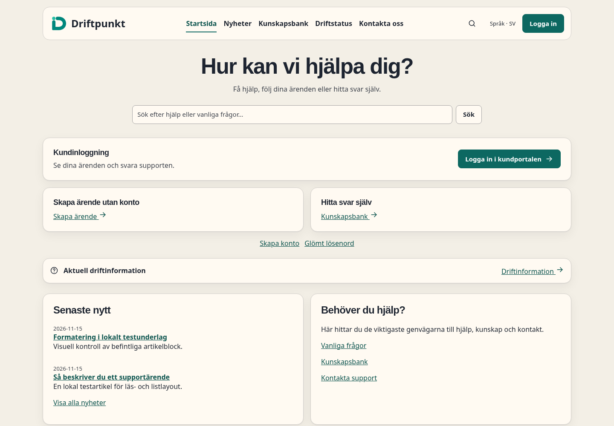 | 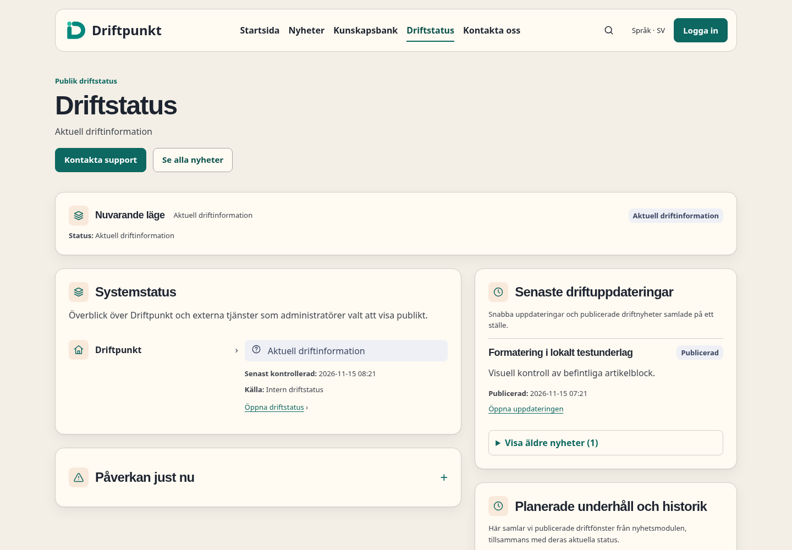 |

| Contact page | Maintenance mode |
| --- | --- |
| 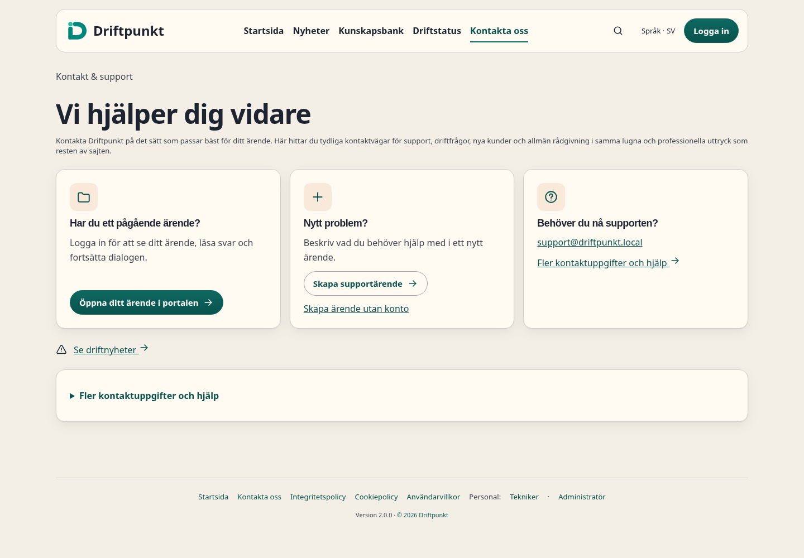 | 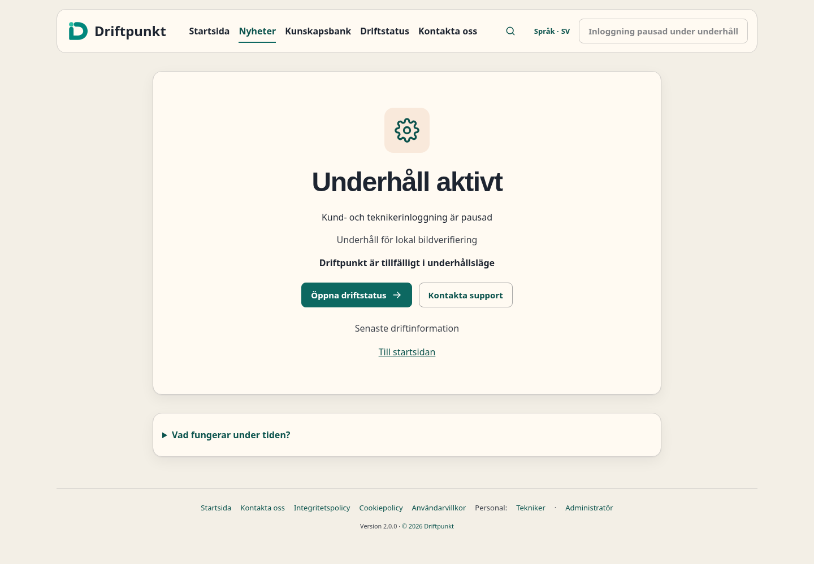 |

| Customer portal | Ticket conversation |
| --- | --- |
| 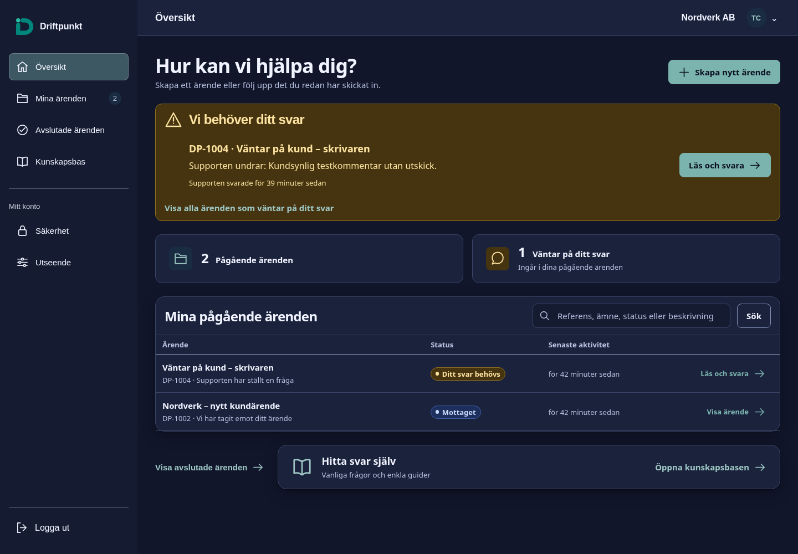 | 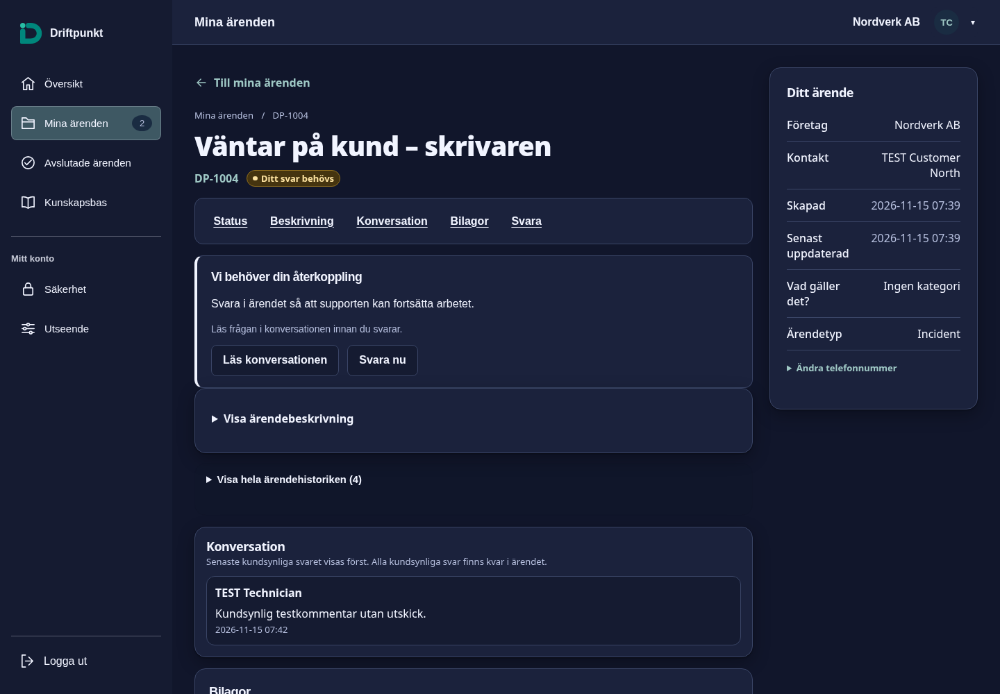 |

| Technician overview | Technician ticket queue |
| --- | --- |
| 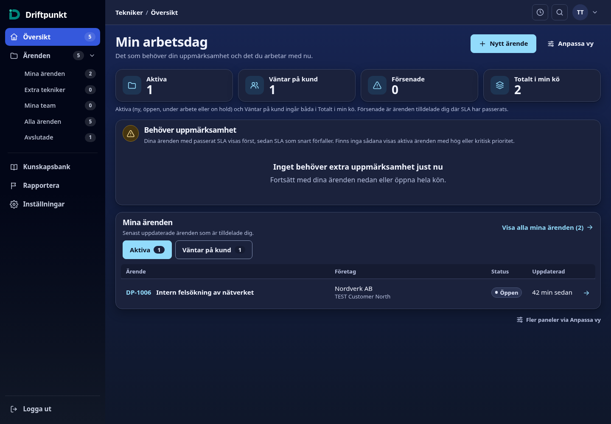 | 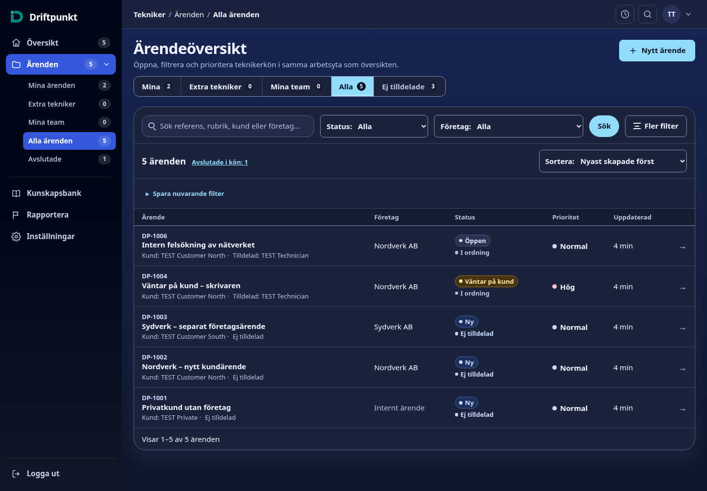 |

| Ticket coordinator | Admin dashboard |
| --- | --- |
| 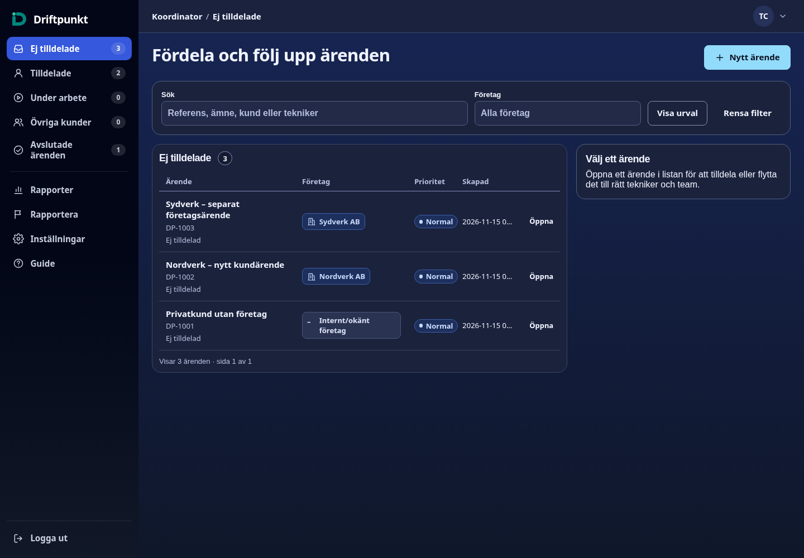 | 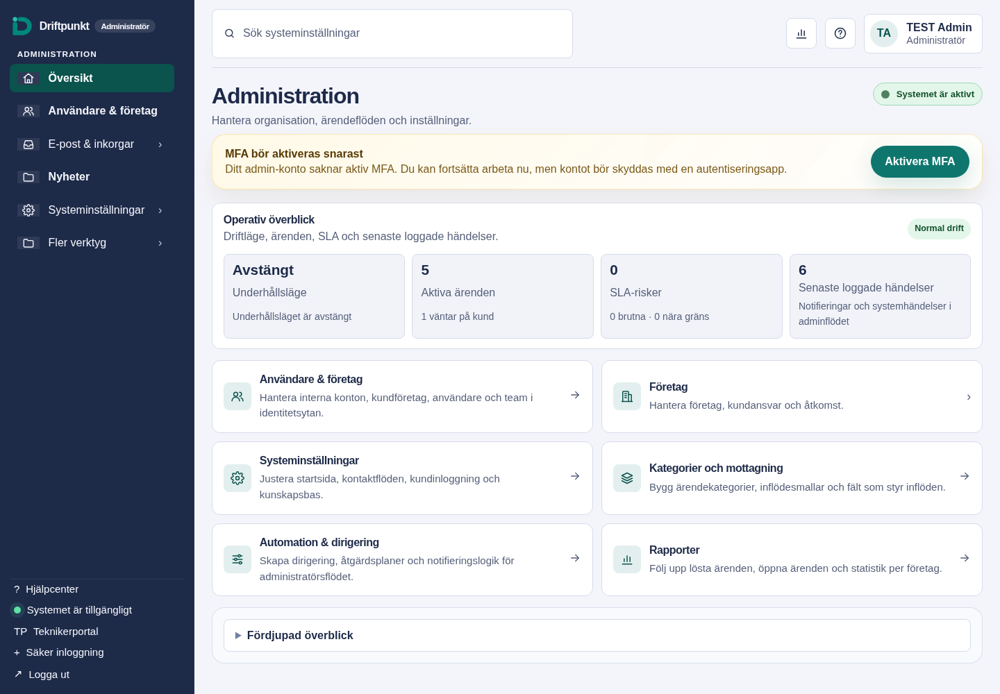 |

<details>
<summary>Mobile view</summary>

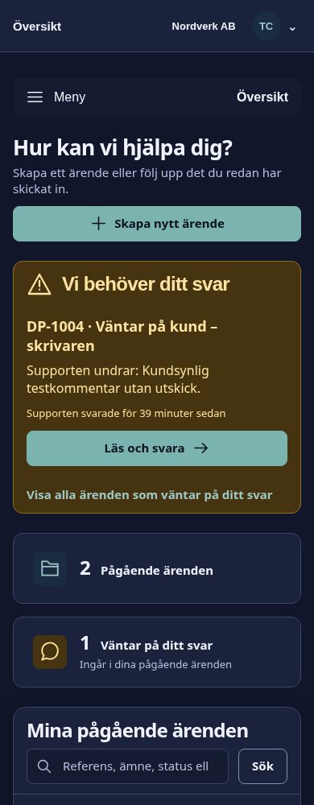

</details>

## What Driftpunkt Includes

- A public website for the homepage, operational status, news, search, contact details, public knowledge base content, and legal policy pages.
- Public ticket intake for visitors when the feature is enabled, plus authenticated customer portals for ongoing support dialogue.
- Customer accounts for both company customers and private customers, including password reset, language switching, personal light, dark, system, and high-contrast portal themes, ticket follow-up, comments, feedback, and customer-visible knowledge base content; super administrators can provision multiple company customers at once with secure temporary passwords.
- Customer-facing resources such as allowlisted company reports, computer lists, and printer lists under a translated "My resources" menu when those resources are enabled.
- Technician and ticket coordinator portals for queue work, triage, comments, assignment, conditional SLA follow-up, reports, activity, notifications, company inventory lookup, and internal issue or feature-request reporting, with a focused two-column technician ticket workbench and clearer personal ticket filtering.
- Full ticket lifecycle support with statuses, priorities, impact levels, request types, routing rules, teams, multiple responsible technicians, internal notes, customer-visible replies, attachments, checklists, playbooks, and customer feedback reminders.
- Admin tools for identity, companies, company hierarchies, teams, mail, ticket categories, intake templates, routing, SLA policies, public content, reports, logs, background jobs, settings, updates, and maintenance mode, with identity work split into focused user, customer, team, appearance, and triage sections.
- Mail ingestion through spool or mailbox polling, incoming mail review, correction drafts, mailbox routing, outgoing profiles, ticket notification emails, and technician/customer links back to the related ticket.
- Knowledge base and news management with public, customer, technician, and admin-facing workflows, optional technician contributions, smart tips, FAQ-style content, and status communication.
- Operational tooling for read-only ticket API access, monthly company reports, database jobs, backups, restore/optimize tasks, migration runs, code update staging, package application, declarative addon management, log export, and controlled cleanup.
- Localization and personalization for Swedish, English, and Norwegian UI text, personal default language in technician, coordinator, admin, and super admin workflows, global default/selectable language governance, customer portal themes, optional lightweight seasonal appearance, branding assets, MFA settings, declarative panels, and internal portal theme templates.
- Release packages with bundled dependencies, metadata, release notes, post-update guidance, and SHA-256 checksums.

## Profiles and What They Can Do

Visible features depend on enabled settings, company access, and role permissions, but Driftpunkt currently supports these main profiles:

### Public Visitor

- Read the public homepage, operational status, news, public knowledge base articles, contact page, and legal pages.
- Search public content from the server-rendered website.
- Create a public support ticket without signing in when public ticket intake is enabled.
- Follow general status and maintenance information published by the service team.

### Company Customer

- Sign in to the customer portal and follow tickets connected to the customer account or shared through the company.
- Create tickets, add customer comments, see ticket status, and participate in the support dialogue for tickets they can access.
- Read customer-visible knowledge base content and operational status information.
- Leave feedback on resolved or closed tickets when customer feedback is enabled.
- Open company resources such as reports, computer lists, and printer lists when the company has the feature enabled and the specific user has been granted access.
- Manage the company computer list when explicitly granted by an admin: add, edit, comment on, and archive computers while keeping their change history.
- Read all customer-visible tickets in the company and its whole subsidiary tree, including private and closed tickets, when a super admin has granted group-wide read access. This access is read-only.
- Use customer reports only when explicitly allowlisted by an admin for that company user.
- Switch portal language between Swedish, English, and Norwegian and choose a personal system, light, dark, or high-contrast portal theme.

### Private Customer

- Register a private customer account when self-registration is enabled.
- Sign in, reset password, create personal support tickets, comment on accessible tickets, and follow personal case status.
- Read customer-visible knowledge base and status information.
- Provide feedback on completed tickets when the feedback workflow is enabled.
- Private customers are separate from company report/resource access, which is controlled per company user.

### Technician

- Work from a technician overview built around assigned tickets, team tickets, queue health, recent activity, and notifications, with SLA cards and controls shown only when SLA is enabled and actively used.
- Open separate personal queues for tickets owned as the primary technician and tickets assigned as a supporting technician, each with a direct sidebar link and count.
- Hide the team's latest tickets or the key figure cards on the dashboard, limit the Overview and Tickets menu counts to tickets assigned to them, choose which page opens after sign-in, and reset these choices to standard in one step.
- Create tickets, take over tickets, assign work, update status, priority, impact, request type, routing, optional SLA fields, checklist progress, and internal work notes.
- Reply to customers, add internal comments, use ticket attachments when enabled, and follow links from technician notification emails back to the related ticket.
- See an intake panel with sender, receiving mailbox, mail linking reason, and attachment warnings, get duplicate suggestions limited to tickets they can already read, and see the planned email recipients before replying.
- Read EML and Outlook MSG attachments including nested emails, preview PDFs, view pasted inline images, download files extracted from `winmail.dat`, and create a separate linked ticket from an attached email.
- See all tickets or only permitted tickets depending on the technician access setting.
- Use knowledge base and news contribution workflows when enabled.
- Report bugs, improvements or feature requests, and missing customers to super administrators from the technician menu.
- Use technician inventory views, dashboard panels, secure login/MFA with configurable trusted devices (14 days by default), personal default language, selectable portal theme templates including seasonal themes that can follow the time of year, and an optional seasonal decoration.

### Ticket Coordinator

- Use a coordinator overview for unassigned work, stale tickets, waiting customer cases, workload, and triage signals, with SLA signals shown only when SLA is in use.
- Distribute tickets to technicians or teams, follow company and queue health, add comments, and keep cases moving without needing full admin access.
- Be responsible for tickets and choose to take over when writing customer-visible comments; internal notes keep the current assignee.
- Use the same intake panel, email reader, attachment recovery, and duplicate suggestions as technicians, and review a summary before approving incoming mail reviews.
- Change ticket priority without changing status, resolution, assignments, or the SLA policy.
- Close active and resolved tickets with a required resolution, including unassigned tickets. Administrative closing sends no customer email; the saved resolution remains visible, and merged source tickets stay read-only.
- Open clearer coordinator and customer reports by company and period for inflow, backlog, status, priority, impact, request type, escalation, risk, ticket aging, and SLA only when applicable.
- Follow an expanded coordinator guide for assignment, priority changes, tickets in progress, closing, comment visibility, reopening, and reporting, and submit internal reports from the same portal.
- View company data plus computer and printer inventory when data exists and access is available.
- Save a personal default language so the coordinator portal opens in the preferred language on the next login.
- Choose which queue selection opens first, such as unassigned tickets or tickets that need attention, and use the same portal and seasonal themes as technicians.

### Admin

- Manage regular operational administration: tickets, companies, users that are not privileged beyond their permission level, teams, categories, routing rules, intake templates, SLA policies, and support settings.
- Configure customer portal features, company hierarchy visibility, ticket attachments, feedback, monthly company reports, MFA policy, public ticket intake, and customer self-registration.
- Choose which customer users may read or manage each company computer list, and configure triage recipients for forwarded original emails when attachments fail.
- Manage public content such as homepage settings, contact information, news, status messaging, knowledge base settings, translation languages, selectable language settings, UI translation overrides, privacy policy, terms, and cookie policy.
- Manage mail servers, support inboxes, outgoing mail profiles, incoming mail review, correction drafts, and mailbox-based ticket creation.
- Use admin reports for ticket inflow, backlog, SLA health, risk, companies, and internal workload.
- Review application logs and notification logs, with super-admin-only controls hidden where appropriate.

### Super Admin

- Has full system and operational access, including all admin and technician capabilities.
- Create or assign privileged profiles such as super admin, admin, and ticket coordinator.
- Create multiple company customer accounts in one operation, with automatic secure temporary passwords and forced password changes at first sign-in.
- Grant selected customer users on a parent company audit-logged, read-only access to all customer-visible tickets in the whole subsidiary tree.
- Review internal reports from technicians and ticket coordinators, update their status, and leave reporter-visible feedback.
- Reset or disable MFA for locked-out users without exposing their MFA secret or enrollment QR code; recovery actions are audit logged.
- Manage destructive or infrastructure-sensitive actions such as database backup/download/restore/optimize, migration execution, code update staging/application, post-update tasks, job retry/purge, log export/cleanup, test ticket purge, branding, support branding, and declarative addon lifecycle.
- Configure global maintenance mode, timezone, default language, selectable languages, optional seasonal appearance for the public homepage and customer portal, system status monitor settings, public ticket form controls, privileged mail tests, knowledge base controls, declarative addon panels, native feature switches, and secure update flows.

### System and Automation

- Poll support mailboxes or process mail spool input and create tickets or draft reviews from incoming messages.
- Run due operational tasks for mail polling, SLA checks, monthly reports, customer feedback reminders, attachment archiving, database jobs, and post-update steps.
- Provide a read-only token-based ticket API for controlled exports.
- Build and apply cumulative install/upgrade packages with vendor dependencies included, release metadata, and checksum verification.

## Packages

- Current exported release: `2.0.3`.
- Fresh installation package: `packages/driftpunkt-install-2.0.3.zip`
- Newest cumulative upgrade package: `packages/driftpunkt-upgrade-2.0.3.zip`
- Older upgrade packages are kept as fallback and history, up to the latest 3 upgrade builds available during export.
- SHA-256 checksum files are generated beside every package.
- Public README assets exported here: 20.

## Latest Release Notes

These notes are copied from the packaged release metadata for the current exported version.

### Driftpunkt 2.0.3

### Seasonal themes

- Technicians and ticket coordinators can choose the seasonal portal themes **Spring**, **Summer**, **Autumn** and **Winter**, or **Season**, which switches between them automatically through the year.
- A personal **Seasonal decoration** under **Settings** shows Christmas and New Year around the holidays and the current season the rest of the year. It is off by default and does not change the colour theme.
- Super administrators can set the seasonal appearance for the homepage and customer portal to **Automatic by season and holidays**, so Christmas and New Year are shown without changing the mode by hand.

### Your working day

- Technicians can choose which page opens after sign-in: **Overview**, **My tickets** or, for ticket coordinators, the **coordinator queue**.
- Technicians can hide the key figure cards at the top of the dashboard.
- Ticket coordinators can choose which selection the queue opens on: unassigned, needs attention, open or assigned tickets. A link with an explicit selection always wins.
- **Reset to standard** restores the start page, queue and list choices while keeping theme, seasonal decoration and language.

### Upgrading

- 2.0.3 contains no database migrations. Use the upgrade archive and follow the [2.0.1 upgrade checklist](docs/upgrade_to_2_0_1.md); the same backup and update steps apply.
- Existing users keep today's start page, queue and dashboard until they change the new settings.

## What This Repository Contains

- `packages/`: install and upgrade zip files.
- `packages/*.sha256`: checksum files for package verification.
- `assets/`: logo and screenshots used by this README.
- [Custom addons](docs/addons.md), [JSON schema](docs/addon.schema.json), [example](docs/examples/addon.json) and [2.0.1 upgrade](docs/upgrade_to_2_0_1.md).
- `PUBLIC_EXPORT_MANIFEST.md`: export summary with package versions and checksums.

## Current Runtime Requirements

- PHP `~8.4.27 || ~8.5.12`: 8.4.27 or later within 8.4, or 8.5.12 or later within 8.5. PHP 8.5.11 does not meet these requirements.
- PHP extensions: `ctype`, `curl`, `fileinfo`, `gd` (JPEG/PNG/FreeType), `iconv`, `intl`, `mbstring`, `openssl`, `pdo`, `pdo_mysql`, `xml`, and `zip`; `opcache` is recommended.
- MariaDB 10.11 or later, Composer 2 for deployment and platform checks, and a web server with its document root set to `htdocs/`.
- Production must use `APP_ENV=prod` and `APP_DEBUG=0`. The archives contain production `vendor/` dependencies without development bundles or PHPUnit.

The PHP patch levels above fix CVE-2026-109618 and CVE-2026-109619; see the [official PHP security advisory](https://www.php.net/archive/2026.php#2026-10-21-5). Composer and application ZIP updates do not replace the PHP engine. Maintenance mode does not protect against PHP engine vulnerabilities that can be triggered before application code runs. Stop or isolate public web access while patching an unverified PHP runtime.

Check the actual server and its installed PHP packages before changing them. The packaged `docs/installation_and_deployment.md` explains package inventory, candidate versions, simulated updates, and PHP verification. Update and verify the PHP engine before applying an application or vendor update.

Run these checks in the application environment, using the PHP CLI binary selected for that installation:

```bash
php -v
php --ini
php -m
composer check-platform-reqs --no-dev
```

Compare the reported version against the required PHP series even before applying the new ZIP: the existing installation may have weaker Composer requirements, and a successful autoload alone does not enforce the separate 8.5 minimum. Verify the actual web PHP version and SAPI through a protected request as well; CLI and PHP-FPM or Apache/mod_php may use different versions. Do not publish a `phpinfo()` page.

Restart the PHP-FPM service used by the site, or restart Apache for mod_php, after updating the engine. Restart long-running PHP workers too, and check `PHP_CLI_BINARY` plus the PHP paths used by cron and systemd. Clear and warm the production cache and complete the restart requirements recorded in the release metadata after applying new application code.

## Fresh installation

Use the install package for a new server, NAS, or clean application directory.

1. Download the latest `driftpunkt-install-*.zip` file and its matching `.sha256` file from `packages/`.
2. Verify the package before unpacking it:

```bash
cd packages
sha256sum -c driftpunkt-install-2.0.3.zip.sha256
```

3. Create a clean application directory on the target server or NAS.
4. Unpack the zip file into that directory.
5. Point the web server document root to the unpacked application directory's `htdocs/` folder. On shared hosting where the fixed public directory is already named `/htdocs`, unpack the whole package there and keep the package root `.htaccess` enabled.
6. Configure the environment file for your deployment. Start from the example files included inside the package and set `APP_ENV=prod`, `APP_DEBUG=0`, real secrets, database credentials, mail settings, and domain-specific values.
7. Start the database and web runtime for your deployment model.
8. Run the installer from the unpacked application directory:

```bash
php bin/console app:install:fresh --env=prod
```

9. Create the first super administrator. The command prompts for and confirms the password without echoing it:

```bash
php bin/console app:create-admin admin@example.com --first-name=First --last-name=Last --type=super_admin --env=prod
```

10. Sign in and open **Settings → Access → MFA policy**. Create or import the MFA encryption key, choose MFA availability, optionally choose required roles, and select the trusted-device period. No role is forced to use MFA automatically.

## Install on a new Debian server

This flow installs Driftpunkt without Docker on a clean Debian server. Replace `driftpunkt.example.com`, passwords, and mail settings before production use.

1. Install the tools needed to unpack the release package:

```bash
sudo apt-get update
sudo apt-get install -y unzip
```

2. Download or copy `driftpunkt-install-2.0.3.zip` and `driftpunkt-install-2.0.3.zip.sha256` to the server, then verify the package:

```bash
sha256sum -c driftpunkt-install-2.0.3.zip.sha256
```

3. Unpack the release into `/var/www/driftpunkt`:

```bash
rm -rf /tmp/driftpunkt-install
mkdir -p /tmp/driftpunkt-install
unzip driftpunkt-install-2.0.3.zip -d /tmp/driftpunkt-install
sudo mkdir -p /var/www/driftpunkt
sudo cp -a /tmp/driftpunkt-install/driftpunkt-install-2.0.3/. /var/www/driftpunkt/
cd /var/www/driftpunkt
```

4. Run the Debian setup script. It installs Apache, PHP packages, MariaDB, Composer, logrotate, and Driftpunkt systemd timers:

```bash
DOMAIN=driftpunkt.example.com sudo -E bash deploy/debian/setup.sh
```

5. Edit `/var/www/driftpunkt/.env.local`, keep `APP_ENV=prod` and `APP_DEBUG=0`, and set real values for `APP_SECRET`, `DEFAULT_URI`, `DATABASE_URL`, `MAILER_DSN`, and `MAILER_FROM`:

```bash
sudo nano /var/www/driftpunkt/.env.local
```

6. Create the MariaDB database and user. Use the same password in `DATABASE_URL`:

```bash
sudo mariadb
```

```sql
CREATE DATABASE driftpunkt CHARACTER SET utf8mb4 COLLATE utf8mb4_unicode_ci;
CREATE USER 'driftpunkt'@'localhost' IDENTIFIED BY 'change-this-database-password';
GRANT ALL PRIVILEGES ON driftpunkt.* TO 'driftpunkt'@'localhost';
FLUSH PRIVILEGES;
EXIT;
```

7. Initialize Driftpunkt:

```bash
sudo -u www-data php /var/www/driftpunkt/bin/console app:install:fresh --env=prod
sudo -u www-data php /var/www/driftpunkt/bin/console app:create-admin admin@example.com --first-name=First --last-name=Last --type=super_admin --env=prod
```

8. Confirm that Apache serves `/var/www/driftpunkt/htdocs`, then reload Apache and add HTTPS, for example with Certbot:

```bash
sudo apache2ctl configtest
sudo systemctl reload apache2
sudo apt-get install -y certbot python3-certbot-apache
sudo certbot --apache -d driftpunkt.example.com
```

9. After the database, first account, backups, and application access have been verified, enable the external background timers:

```bash
sudo systemctl enable --now driftpunkt-mail-poll.timer driftpunkt-attachment-archive.timer
systemctl list-timers 'driftpunkt-*' --all --no-pager
```

Attachment ZIP archiving is configured under **Administration → Settings → Tickets → Ticket attachments**. A retention value of `0` archives local attachments as soon as a ticket is resolved or closed. Choose a higher value when recently closed tickets should keep separate files for a grace period. If the installation uses a custom Unix account, application path, or PHP binary, update `driftpunkt-attachment-archive.service` accordingly before enabling it.

## Install on a new NAS with Docker Compose

This flow uses the Docker Compose stack included inside the install package. Adjust `/volume1/docker/driftpunkt` to the application path used by your NAS.

1. Copy `driftpunkt-install-2.0.3.zip` and `driftpunkt-install-2.0.3.zip.sha256` to the NAS, then verify the package:

```bash
sha256sum -c driftpunkt-install-2.0.3.zip.sha256
```

2. Unpack the release into a persistent NAS folder:

```bash
rm -rf /tmp/driftpunkt-install
mkdir -p /tmp/driftpunkt-install /volume1/docker/driftpunkt
unzip driftpunkt-install-2.0.3.zip -d /tmp/driftpunkt-install
cp -a /tmp/driftpunkt-install/driftpunkt-install-2.0.3/. /volume1/docker/driftpunkt/
cd /volume1/docker/driftpunkt
```

3. Create and edit the NAS environment file:

```bash
cp deploy/nas/.env.example deploy/nas/.env
nano deploy/nas/.env
```

Keep `APP_ENV=prod` and `APP_DEBUG=0`, and set real values for `APP_SECRET`, `DEFAULT_URI`, `MARIADB_PASSWORD`, `MARIADB_ROOT_PASSWORD`, `DATABASE_URL`, `MAILER_DSN`, and `MAILER_FROM`. After signing in, configure the internal-report recipient and reply mailbox in the super-admin cockpit.

4. Create persistent data folders and start the stack:

```bash
mkdir -p deploy/nas/data/var deploy/nas/data/mariadb
docker compose -f deploy/nas/compose.yaml --env-file deploy/nas/.env build --pull app &&
  docker compose -f deploy/nas/compose.yaml --env-file deploy/nas/.env up -d --force-recreate app scheduler
```

Stop if the build fails. If the official multiarchitecture base image manifest is unavailable, follow the explicit AMD64-only `PHP_BASE_IMAGE` option in `docs/installation_and_deployment.md` inside the package, after checking the Docker server architecture. Do not substitute an older PHP tag or an old cached application image.

5. Initialize Driftpunkt inside the app container:

```bash
docker compose -f deploy/nas/compose.yaml --env-file deploy/nas/.env exec --user www-data app php bin/console app:install:fresh --env=prod
docker compose -f deploy/nas/compose.yaml --env-file deploy/nas/.env exec --user www-data app php bin/console app:create-admin admin@example.com --first-name=First --last-name=Last --type=super_admin --env=prod
```

6. Open the URL from `DEFAULT_URI`, sign in, configure the MFA policy without enabling mandatory MFA unless explicitly wanted, and confirm that the app and scheduler containers are healthy:

```bash
docker compose -f deploy/nas/compose.yaml --env-file deploy/nas/.env ps
docker compose -f deploy/nas/compose.yaml --env-file deploy/nas/.env logs -f app scheduler
```

## Automatic Customer Registration and Company Groups

As super administrator, edit an inbox, link an active company, allow unknown senders, and enable automatic customer registration. Configure exact sender domains on the inbox or email domains on the company and its subsidiaries under Administration → Companies, for example `company.example`. Enter subdomains separately; do not use `@` or wildcards.

A sender domain matching an active company in the inbox company branch creates the new contact on that company and a private ticket. Company domains take precedence over the inbox domain list. If only the inbox domain list matches, the inbox company is used. Existing contacts and aliases in the same branch are reused without moving contacts between companies.

Company domains can also route review drafts to the correct subsidiary when automatic registration is disabled. Drafts requiring review notify the configured triage recipients and link to the Unknown tickets queue. If an inbox rejects unknown senders, their messages are rejected even when they contain a reply or ticket reference.

To retain the previous workflow for a company group:

1. Sign in as super administrator and open Administration → Companies.
2. Open the parent company, enable **Behåll tidigare mejlhantering** (keep previous mail handling), and save the mail settings.
3. The exception applies to the parent and all descendants at every level, even when their inbox automation is enabled.

A child cannot override an inherited exception. The company and inbox views show its source. Removing an exception restores saved inbox settings unless another ancestor still has an exception. Existing contacts, tickets, and review drafts remain unchanged.

Automatically registered contacts receive no portal invitation. Login, login links, existing portal sessions, and password reset are blocked until an administrator enables **Portalåtkomst** (portal access) in the user form. Domain matching is a company-routing rule, not identity verification.

Enable this first on a test inbox. For multiple application servers, configure a shared `LOCK_DSN`; with default file locking, web and scheduler must share `var/lock`. The archives include `docs/automatic-mail-customer-registration.md` with setup, migration, and troubleshooting instructions.

## Upgrade an existing installation

1. Use the newest cumulative `driftpunkt-upgrade-*.zip` package first. It contains the full current codebase and is the normal path even when the installed site is several releases behind.
2. Back up the database and application files before applying the upgrade.
   Preserve `.env.local` and its `APP_SECRET` in an encrypted, restore-tested backup. The secret is required to unwrap the stored MFA encryption key. Include `var/share`, `var/ticket_attachments`, `var/ticket_attachment_archives`, `var/incoming_mail_attachments`, and uploaded branding in `htdocs/assets/branding`, plus external storage paths if configured.
3. Verify the checksum before using the package:

```bash
cd packages
sha256sum -c driftpunkt-upgrade-<version>.zip.sha256
```

4. Update and verify the PHP engine for both web and background jobs before applying the ZIP. Keep `APP_ENV=prod` and `APP_DEBUG=0`, then apply the package through the Driftpunkt admin update flow when available, or unpack it according to your deployment procedure. Preserve the existing environment and `APP_SECRET`; do not run `composer update` on the server.
5. Confirm that the web server document root points to `htdocs/`, or that the package root `.htaccess` is active when the whole package lives in a fixed `/htdocs` directory.
6. Run database migrations, cache refresh, service reloads, and any other post-update steps listed in the package metadata and release notes.
7. Older upgrade packages are kept as fallback and history, not as required intermediate steps.
8. Verify login, ticket creation, customer/technician portals, status page, and background jobs before leaving maintenance mode.
9. Verify `systemctl --failed`, mail polling, and the attachment-archive service log after its first scheduled run.

Installations still on 1.x must follow the [live-server upgrade checklist for 2.0](docs/upgrade_to_2_0_0.md) first. Between 2.0 releases, follow [the 2.0.1 upgrade checklist](docs/upgrade_to_2_0_1.md); 2.0.2 and 2.0.3 add no database migrations.

## Available upgrade packages

- `packages/driftpunkt-upgrade-2.0.3.zip`
- `packages/driftpunkt-upgrade-2.0.2.zip`
- `packages/driftpunkt-upgrade-2.0.1.zip`

## Notes

- Keep private `.env`, backup, database dump, and customer files outside this repository.
- Driftpunkt release packages prefer `htdocs/` as document root. If the full package must live directly in a fixed `/htdocs` web root, verify that `.htaccess` blocks `config/`, `src/`, `vendor/`, and `var/` before production use.
- Review `PUBLIC_EXPORT_MANIFEST.md` after every export before committing to the public repository.
- If checksum verification fails, do not install the package. Rebuild and export the release from the private repository.

## GitHub Releases

Maintainers can run Actions → Prepare GitHub Release after exporting and pushing this repository. Enter the exported version, such as `2.0.3`.
The workflow verifies both package checksums and the release-note version, then creates a draft release with the installation package, upgrade package, checksums, and release notes. Review and publish the draft from GitHub Releases.

## License

- Driftpunkt is proprietary software distributed under the **Driftpunkt Free Use License 1.0**.
- Driftpunkt is free to use for individuals, businesses, and organizations, including commercial internal operations.
- Resale, redistribution, repackaging, and distribution of modified versions are not permitted without prior written authorization.
- See [LICENSE.md](LICENSE.md) for the full license terms.
